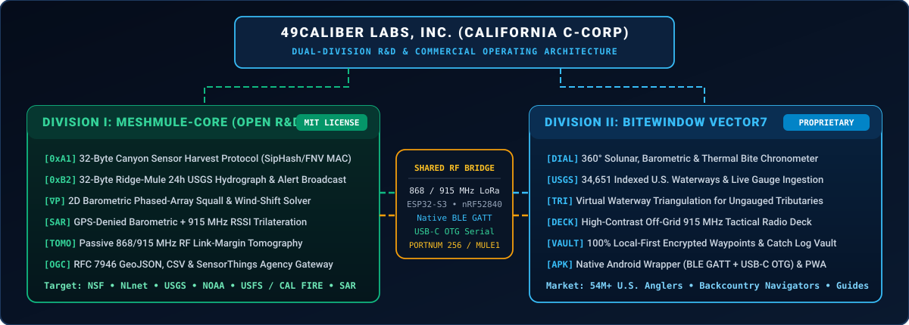

  

   

  
  
  
  
  

---

## 🧭 1. Company Overview & Mission

**49Caliber Labs, Inc.** is a California applied research, RF telemetry, and environmental systems engineering corporation founded by **[Joel T. (`@J-O-E-L-T`)](https://github.com/J-O-E-L-T)**.

We design and deploy **off-grid sub-GHz (868 / 915 MHz) LoRa delay-tolerant communication protocols**, **distributed atmospheric and hydrological sensor networks**, **GPS-denied backcountry Search-and-Rescue (SAR) positioning engines**, and **high-contrast environmental telemetry platforms**. By uniting first-principles atmospheric and RF physics with deterministic bit-level protocol engineering, **49Caliber Labs, Inc.** builds zero-stub, field-verified systems engineered for cellular-denied river canyons, austere forested basins, and maritime environments.

---

## 🏛️ 2. Corporate Structure & Dual-Division Operating Architecture

**49Caliber Labs, Inc.** operates through two synergistic divisions sharing a common hardware-agnostic sub-GHz LoRa transport bridge while maintaining strict open-source vs. commercial intellectual property boundaries:

  

 

| Division | Repository & License | Core Deliverables & Target Partners |
| :--- | :--- | :--- |
| **Division I: Open-Source RF & Citizen-Science Infrastructure** | **[`49Caliber-Labs/MeshMule-core`](https://github.com/49Caliber-Labs/MeshMule-core)** *(MIT Open Source)* | • **32-Byte Binary Wire Protocol (`0xA1` / `0xB2`):** Deterministic sub-65ms LoRa frames with 16-bit CRC-CCITT and 32-bit keyed MAC authentication. • **2D Distributed Barometric Phased-Array ($\nabla P$):** Hypsometric sea-level normalization ($P_0$) + Ordinary Least Squares planar pressure-gradient squall solver. • **GPS-Denied Canyon SAR Navigation:** Barometric elevation contour lock + 868/915 MHz RSSI/SNR link-margin trilateration & dead reckoning. • **Passive RF Atmospheric Tomography:** Inter-node link-margin residual inversion for localized precipitation & canopy moisture mapping. • **Agency Collector Gateway:** Multi-mule witness deduplication + **RFC 7946 GeoJSON**, **CSV**, and **OGC SensorThings** exports for **USGS, NOAA, USFS, CAL FIRE, NLnet, and SAR**. |
| **Division II: Commercial Tactical Telemetry Platforms** | **[`49Caliber-Labs/bitewindow-vector7`](https://github.com/49Caliber-Labs/bitewindow-vector7)** *(Proprietary Commercial)* | • **7-Vector Environmental Synthesis:** Real-time synthesis of barometric rate-of-change, thermal optimums, solunar transits, USGS discharge/stage, wind state, and crepuscular angles into a **360° Feeding Window Chronometer**. • **34,651 Indexed USGS Waterways:** Nationwide 50-state hydrographic index with live gauge ingestion and Virtual Waterway Triangulation for unmonitored tributaries. • **Native Android & Hardware Transceiver Bridge:** Direct Native Android BLE GATT (`BleClient`), Web Bluetooth, USB-C OTG Serial (`0x94 0xC3`), and Wi-Fi HTTP pairing with ESP32-S3 and nRF52840 LoRa transceivers. |

---

## 🔬 3. Industry & Scientific Contributions

1. **Zero-Satellite Backcountry Sensor Harvesting (`0xA1` Protocol):** Eliminates $5,000–$30,000 per-node satellite station costs for remote stream temperature, stage, wildfire RAWS, and salmonid thermal refugia monitoring by turning hikers, rangers, and anglers into cryptographic store-and-forward data mules.
2. **Dead-Zone Canyon Flood & Hydrograph Telemetry (`0xB2` Ridge-Mule):** Compresses a 24-hour USGS river discharge curve and severe-weather alerts into a single 32-byte LoRa frame broadcast from ridge repeaters into deep canyon corridors.
3. **Peer-to-Peer Meteorological Phased Arrays ($\nabla P$):** Transforms ad-hoc groups of field radios into a synthetic aperture barometric array capable of detecting approaching convective squall fronts and canyon wind reversals offline.
4. **Redundant Backcountry Life-Safety Positioning:** Delivers a deterministic positioning fallback (barometric contour lock + RF tomography + dead reckoning) when canyon walls block GNSS satellites.

---

## 🤝 4. Institutional Grants, Partnerships & Sponsorship

**49Caliber Labs, Inc.** collaborates with federal, state, and European research agencies, watershed conservation districts, and Search-and-Rescue organizations to deploy open-source **MeshMule-Core** sensor networks and custom telemetry bundles.

- **Sponsorship & Research Grant Matrix:** **[github.com/J-O-E-L-T (Sponsorship & Grant Tiers)](https://github.com/J-O-E-L-T#-github-sponsors--research-grants-why-back-my-work)**
- **Founder & Principal Systems Architect:** **[Joel T. (`@J-O-E-L-T`)](https://github.com/J-O-E-L-T)**
- **Flagship Open-Source Repository:** **[github.com/49Caliber-Labs/MeshMule-core](https://github.com/49Caliber-Labs/MeshMule-core)**
- **Flagship Commercial Repository:** **[github.com/49Caliber-Labs/bitewindow-vector7](https://github.com/49Caliber-Labs/bitewindow-vector7)** *(Private Commercial Codebase)*
